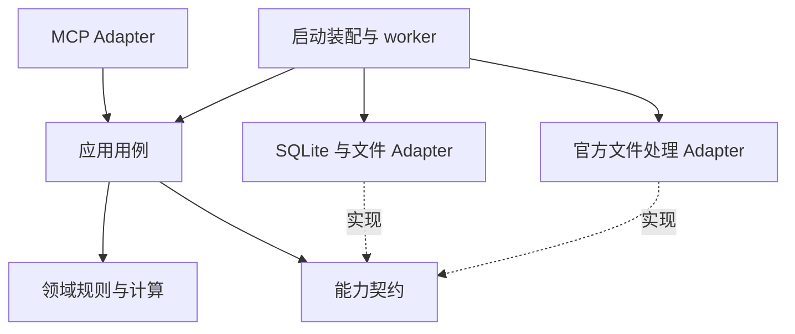

# 整体设计

## 最新目标入口

[通用数据工具设计](generic-data-tools.md)定义当前目标：工具按业务动作稳定，dataset 参数使用类型化 schema 扩展。本轮取代本文旧的“新类别新增工具”入口选择；旧名称在覆盖表中仅表示业务能力，映射以新设计为准。公共任务和 SQLite 模型也须按新设计修正，实现前不能固化为行情专用。

## 文档状态与权威入口

设计任务 [#75](https://github.com/liqiangcc/x-data-mcp/issues/75)，日期 2026-09-12。
代码核对基线：`b3fe2b3bae22d558c3f193e668773728a2e0df34`（#70 已合并）。
本文描述目标架构，并显式列出当前实现差距；不构成真实来源、迁移或部署通过的证明。

用户已确认首期 SQLite，并授权编写整体设计及 MCP tools。模块划分、后续工具名称、
字段和运行方案属于本次设计提案，不伪装成用户逐项批准的业务规则。
需求以 #1/#3/#4/#5/#6 的当前确认段落及后续明确修正为依据；
官方文件方向由 #55 承接，旧在线来源和源端年线文字已被替代。
来源未决项不能通过设计、fixture 或布尔开关放行。

| 内容 | 权威入口 |
|---|---|
| 产品范围及访问边界 | [#1](https://github.com/liqiangcc/x-data-mcp/issues/1) |
| 首次采集、幂等、取消、重试和核实 | [#3](https://github.com/liqiangcc/x-data-mcp/issues/3) |
| 更新、补采、修订和原版本恢复 | [#4](https://github.com/liqiangcc/x-data-mcp/issues/4) |
| 查询、进度、版本和完整性保护 | [#5](https://github.com/liqiangcc/x-data-mcp/issues/5) |
| 当前沪深 A 股和 TDX 研究行业二级 | [#6](https://github.com/liqiangcc/x-data-mcp/issues/6)、[官方文件架构](production-source.md) |
| 工具输入、输出及行为 | [MCP tools 契约](mcp-tools.md) |
| SQLite schema、事务、迁移和备份 | [SQLite 设计固定提交](https://github.com/liqiangcc/x-data-mcp/blob/2ff75b5e1c86052e3d114e909ec33a7d946e198d/docs/sqlite-storage-design.md)，[PR #72](https://github.com/liqiangcc/x-data-mcp/pull/72) |
| 工程规范 | [规范采用说明](conventions.md) |

SQLite 文档尚在独立 PR，使用固定链接避免主分支缺文件。合并后将入口改为本地相对链接，
不复制第二份 schema。其“保留期限未确认”应理解为未来清理策略未定：
#4 已明确首期不自动清理已发布版本及关联说明，容量不足明确失败。
本设计按此已确认规则执行，不能将保留能力降为可选。

## 产品闭环与排除范围

本人及授权 AI 可以刷新目录、首次采集、手动更新与补采、查询行情与版本、
查看未完成项、取消、显式重试，以及按证据核实不确定结果或恢复受损版本。
这些是完整目标，不因当前仅暴露八个工具而缩减。

首期当前沪深 A 股、前复权日线与本地自然年派生年线；不自动纳入北交所、ETF、
退市证券补齐、分钟线、财务、订单执行或管理网页。
历史起点以来源可审计能力为准，不预设统一年份。
不做首期定时更新；持续运行的 worker 只执行显式受理任务，不能等同自动定时采集。
不将保存历史版本等同于无前视偏差回测数据。

可用数据、执行完成和历史完整分别表达：任务已结束可能包含失败或覆盖待核实；
更新失败可同时存在旧有效数据；空结果不证明停牌、退市或无交易。

## 当前能力与目标差距

| 能力 | 基线事实 | 目标 / 依赖 |
|---|---|---|
| MCP | stdio 原型，八个工具，#68 查询已合并 | 全部业务入口、稳定契约及真实客户端验收 |
| 任务 | 受理/取消/重试、JSON 单快照、显式 worker | SQLite 事务、后台独立生命周期、核实与请求级终态 |
| 行情 | JSON 单点发布、摘要与历史读取 | SQLite 逐行行情、原子 head 与结果关联 |
| 原始 .day | 32 字节结构解析已实现 | 单位和来源语义、目录与事件快照组合校验 |
| QFQ / GBBQ | 生产处理仍拒绝 | #54 数值与事件契约，不容差放行 |
| 年线 | 纯聚合核心；查询可核对固定 daily 聚合 | 接入真实发布流程并保留逐年血缘 |
| 目录 | 核心规则存在 | 官方目录与研究行业二级映射证据 |
| 服务 | 单进程同步 stdio；无持续 worker 交付证据 | 守护进程、访问控制、客户端断开与重启验收 |
| 性能 / 全市场 | 未验证 | 固定规模、环境、提交后实测 |

当前缺少执行记录时 get_task 可显示 pending；retry_task 复用响应固定 pending；
Running 被读接口统一映射为 needs_verification。这些是现状差距，不是目标业务契约。
必须在后台运行或 SQLite 切换前补齐回归，不能把显示转换当作已实现重启核实。

## 架构与依赖方向

箭头表示代码依赖/装配关系。领域层不依赖 MCP、SQL 或网络。
同一份校验、幂等和发布决策供 MCP、worker 和迁移验证使用，避免入口各自实现。

| 部分 | 现有定位 / 目标职责 |
|---|---|
| 领域 | market_data、catalog、yearly：身份、范围、证据、精确数值和聚合 |
| 应用 | collector、execution、task、publish、query：用例编排、固定输入、状态转换 |
| 能力契约 | MarketDataPipeline 已存在；按真实用例补原子受理/发布和 verified read 的存储契约 |
| 基础设施 | storage/TaskStore 当前直接 JSON；后续 SQLite 和不可变原始文件实现契约 |
| 入口 | mcp 负责参数、协议、权限上下文；bin 负责配置和装配 |
| 执行 | worker 领取已受理任务；不得在业务计算中自行选择来源或解除门禁 |

当前应用直接依赖具体 JSON 存储，属于待改造点，不宣称分层已经全部实现。
按可验收用例提取契约，不为每张表创建 trait，不拆空 crate 或增加通用工作流引擎。

## 端到端流程

### 目录刷新

显式请求 → 固定官方文件快照 → 解析身份与行业 → 校验范围、分页/文件完整性、
重复与冲突 → 构造候选目录 → 原子发布新目录版本。
缺失行业按 #6 降级规则标记；整个行业来源未成立不能用“缺失可接受”掩盖。
刷新失败保留旧有效目录；首次失败报告无可用目录。
成员消失不能自动删除；动态采集范围只在首次受理时解析并固化目录版本与成员清单。

### 首次日线及年线

1. 验证权限和参数；原子绑定 request_id、任务、冻结范围和占用，再返回受理结果。
2. worker 在写事务外获取并固定 base/行业、.day、gbbq 的独立内容身份与来源证据。
3. 解析保留原始位模式，分别验证单位、字段、事件、覆盖与快照兼容性。
4. 用已验证规则生成本地 QFQ；输入包括 raw daily version、event version、
   catalog version、算法版本、复权基准与一致性证据。
5. 按单个证券/周期执行项校验候选；单项不完整或部分记录失败则不发布其部分正常记录。
6. 发布日线版本后，年线固定一个已发布 QFQ daily version，按自然年计算并独立发布。
   无基础日线明确拒绝，不隐式调用外部年线或追加采集。
7. 持久化单项结果、任务状态和占用释放证据。单项失败可继续其他可执行项；
   来源级故障的停止边界按 #3，不能一律逐股无限重试。

年线 OHLC 为首开、最高、最低、末收；量额仅全部已知且单位/币种一致才精确相加。
逐年记录首末参与交易日、基础版本、算法与计算 as_of；未结束年度明确标识。
发布时重新检查基础版本资格；基础变化产生新年线候选，不能暗中改写旧血缘。

### 更新与补采

手动更新默认针对当前目录中已启动首次采集的证券；新成员需走首次采集。
固定本次范围，更新最新行情并尝试补齐已确认缺口；未知日期不能仅凭不连续认定漏采。
区间发布保留范围外事实，来源未返回旧记录不自动删除。
QFQ 事件修订可能改变全历史；无法证明与范围外同基准时拒绝局部拼接，
要求调用者显式扩大重采范围，不偷偷扩容请求。
内容无变化、仅元数据变化、历史修订分别按 #4 判定；精确相等不能仅比较文本格式。
日线修订使受影响年线重新生成；无法界定影响范围时不能宣称旧年度全部仍一致。

### 读取与研究

只读解析固定版本 → 核验完整性与请求匹配 → 索引筛选 → 固定分页 → 返回元数据与限制。
后续分页不重新选 latest。版本列表也固定首个查询快照；坏版本不被静默略过。
年线重算仅作校验，不在查询中发布新结果。
跨证券分析记录每只证券的版本清单与目录版本；当前行业快照不是历史日期行业分类。
精确小数 TEXT 与 Decimal 计算边界、分析 SQL 见 SQLite 专项。

## 数据治理不变量

- 身份包含交易所与六位代码；文件名/代码规律不能替代目录证明。
- 原始内容不可变并有 SHA-256；获取时间、来源时间、交易日期、发布时间分开。
- 数值采用精确十进制，未知量额为 NULL；不推断单位、不补零、不拟合来源差异。
- published 仅在门禁通过后可见；版本内容、血缘和关联说明不可原地修订。
- 每次派生固定输入身份，存储摘要只证明内容一致，不证明业务来源正确。
- 已发布历史版本首期不自动清理，空间不足明确失败；恢复副本不能覆盖成不同内容。
- 原 request_id 重发不能重新执行；参数规范化和契约版本参与幂等判断。
- 无法判断是否已提交时先核对持久证据，不猜测失败并释放保护。

## 任务与恢复模型

目标执行阶段、业务结果和数据可用性分别保存，不以一个 success 布尔值表达全部事实。
采集/更新执行项按证券 × 周期；核实任务按证据检查项，不能机械套用股票计数。

| 阶段 / 情形 | 允许动作与保护 |
|---|---|
| 未受理 | 参数/权限失败无业务写副作用；普通拒绝不消费标识，特定请求级终态按 #3/#4 |
| pending | 已持久占用全部声明范围；可领取或取消 |
| running | 保存实际进度；取消转 cancel_requested，不能等同已停止 |
| cancel_requested | 停止新增工作并核对在途副作用；证据不足继续保护 |
| needs_verification | 保留最后已知状态和占用；只能由明确证据核实安全收尾 |
| succeeded / partially_failed / failed / cancelled | 终态与实际单项结果一致；重试建关联新任务 |
| interrupted（目标待实现） | 重启核实停止后的原任务终态；继续处理只能显式重试 |

重启前未结束任务不能自动恢复执行，也不能把所有旧 pending 当新队列。
设计使用服务启动身份和执行 owner 记录区分本次新受理任务与历史任务；
领取、取消和收尾采用事务及条件更新。旧 owner 不存在并不能独自证明所有外部写入已停止，
核实还须检查持久发布事实和在途执行证据。

四类核实分别检查停止写入、发布结果、恢复结果、受理异常。
受理核实创建独立任务，不接管或释放原占用；同目标同类并发及不同类串行遵循 #3。
核实本身异常时用有界管理操作检查现有证据，不递归创建核实任务；
一次检查即使证据不足，也持久绑定该 request_id，想检查新证据需新标识。

恢复原版本是显式异步写任务：可靠副本必须同时证明行情和关联说明一致，
保留原 ID 并记录审计。不满足条件时原版本仍不可用，重新采集只能产生新版本。
恢复不是切换 head 到任意旧版本，也不授权删除历史。

## 原子边界与故障处理

SQLite 原子受理、发布及文件先落盘规则由专项设计定义。一次全市场任务不要求全市场大事务，
单项事务必须保证 batch、version、head 与任务输出关系一致。

| 故障 | 行为 |
|---|---|
| 下载/解析/来源证据失败 | 记录失败或限制，不发布；旧数据可按原版本读取 |
| 发布提交前退出 | 新候选不可见，旧 head 保留 |
| 提交结果不明 | 待核实，按 request/task/version 持久关系重查，不重复副作用 |
| 客户端断开 | 目标服务继续已受理任务；断开不是业务取消 |
| 服务重启 | 历史未结束任务待核实，保留范围保护 |
| 请求绑定损坏 | 不伪造未绑定/Pending；受理异常核实 |
| 数据库/版本损坏 | 查询明确不可用，不回退旧 JSON、旧版本或空库 |
| cursor 失效 | 明确新查询；不拼接旧页和新版本 |
| 容量耗尽 | 明确失败并保留事实，不静默清理历史 |
| 恢复证据不足 | 原版本不可用，保护不自动解除 |

## 运行、访问与配置设计

目标首期单主机、一个业务写 worker、多个授权读取者。建议一个受监督的长期服务拥有任务队列
和 SQLite 写连接；MCP 会话作为入口连接该服务，客户端生命周期不拥有任务执行生命周期。
首期仍手动触发采集，不加定时调度。run_worker_once 作为原型/运维能力，
不得与后台 worker 竞争领取；未来运行模式必须互斥或复用同一领取器。

当前 stdio 是同步逐行原型，EOF 结束入口；耗时 run_worker_once 会阻塞同连接，
不能依靠同连接 cancel 实现并发取消。
推荐先以受保护本机 IPC 桥接长期 worker；若使用远程 MCP，
须另行交付传输协议、认证、授权撤销与真实客户端联调。
本设计不擅自选 OAuth/token、不开放匿名 HTTP，也不宣称 stdio 本身有远程认证。
OS 账户/文件权限属于本机信任边界；拥有 cursor、task_id 或自称 AI 不构成授权。

装配负责数据库路径、原始文件目录、schema 升级、独占写入、busy/停止预算及日志输出；
密钥不进仓库。stdout 仅协议输出，日志独立通道。审计记录写操作身份、目标、时间、
request/task ID、证据与结果；普通参数拒绝保持无业务写副作用，拒绝日志策略另行定义。
正常退出停止领取并有界等待，不能在退出时伪造成功或释放未核实占用。
超时/容量参数属于工程限制，需可见、可测，不能被当作业务完成标准。

备份、恢复、schema 升级和数据迁移采用独立管理入口及停写/核验流程，
详见 SQLite 专项。部署必须验证重启、断连、独占、权限和磁盘故障；
仅合并 PR 不等于服务交付。

## 需求覆盖与实施依赖

| 需求 | 工具 / 应用能力 | 验收重点 |
|---|---|---|
| #6 目录 | refresh_catalog、get_catalog（拟议） | 真实映射、失败保旧、成员消失、固定版本 |
| #3 首次采集 | start_collection、worker、publisher | 原子受理、实际范围、单项完整校验与来源门禁 |
| #4 更新补采 | update_market_data、backfill_market_data（拟议） | 显式范围、范围外保护、修订与年线传播 |
| #5 查询 | 三个已实现查询工具 | 固定版本/列表、损坏拒绝、未知和年线血缘 |
| #3/#5 任务 | get_task、get_task_progress（拟议）、cancel/retry | 一致快照、未完成项、终态/幂等、取消证据 |
| #3/#4 核实 | verify_* 四工具（拟议） | 独立请求、证据、不隐式重试、串行保护 |
| #4 恢复 | restore_market_data_version（拟议） | 可靠副本、原 ID、结果不明与审计 |
| #3 异常处置 | inspect_verification_task（拟议） | 有界、不递归、历史检查结果固定 |
| #1 运行 | 守护进程/入口装配 | 授权访问、断连不取消、重启待核实 |

实施顺序：先审查契约与已有差距；并行可推进来源证据与 SQLite fixture 契约；
随后交付事务和真实处理、补齐管理能力与后台运行；最终少量真实证券闭环再全目标范围验收。
这里的“并行”是依赖说明，不向既有 d2 或其他会话派活。

测试分层：领域独立语义证据、用例状态/冲突、真实 SQLite 故障注入、
MCP schema/响应/无副作用、实际客户端与服务器验收。
性能单独记录固定版本、规模、设备、并发、冷/热查询与核验成本，不设未经确认的阈值。
整体关闭前逐项对应 #1 产品 AC；八个工具、fixture 或 SQLite 迁移不能替代全业务验收。

## 仍需落实的决定

来源 #54/#6、文件使用边界和快照兼容性继续阻塞真实生产。
远程传输与认证、核实证据获取及时间预算、候选/日志保留、备份周期与性能指标尚需具体实现任务。
后续工具字段是可评审草案，注册前必须形成 schema、输出和错误快照及对应业务测试。
当前总体状态仍为 NOT_PRODUCTION_READY；本次只交付设计，不宣称迁移、部署或全部业务已完成。

## 关注点、逻辑与控制分离的落实规则

本节补充 #75 设计评审：MCP 是 AI 的业务交互入口。AI 可组合业务意图，
服务负责每个操作的业务约束与一致性。以下是目标边界，不表示现有代码已全部满足。

| 变化原因 | 责任主体 | 输入与输出 | 禁止跨越的边界 |
|---|---|---|---|
| 协议或参数形状变化 | MCP Adapter | wire 参数 → 用例命令；用例结果 → wire 响应 | 不决定是否允许发布/重试 |
| 业务规则变化 | 领域规则 | 明确事实 → 决定、原因与所需前置条件 | 不读数据库、不取系统时间、不发工具调用 |
| 执行顺序或失败处理变化 | 应用用例 | 命令 → 读取事实、调用规则、提交、解释结果 | 不复制规则、不编写 SQL |
| 调度和生命周期变化 | worker / 装配 | 持久任务 → 领取、执行、停止、恢复检查 | 不决定数值口径、不绕过待核实 |
| 持久化技术变化 | SQLite / 文件 Adapter | 条件提交、固定版本读取 → 持久结果 | 不选择业务重试、fallback 或发布策略 |

单一职责按变化原因判断，不按函数行数、工具数量或每张表拆模块。
TaskAcceptance、TaskCancellation、TaskRetry、Verification 各自维护用例控制；
状态合法性和范围冲突规则可共享，事务代码集中于存储 Adapter。
Publisher 拆清“发布规则判断”和“原子提交能力”，不能成为下载、计算、SQL、
任务调度与协议响应的总入口。只在真实变更需要时拆文件/类型，不先建空抽象。

### 业务判断与事务并发检查

目标发布协议：

1. 应用读取候选、基础版本、任务状态及当前 head，形成不可变事实输入。
2. 领域规则返回 PublishDecision（允许/拒绝、原因、所依据的输入身份）。
3. 应用调用 commit_publication，传入候选身份、预期 head、任务状态修订号及占用身份。
4. Adapter 在事务中核对这些前置条件，原子提交 batch/version/head/任务输出关联。
5. 返回 Committed、PreconditionChanged 或 OutcomeUnknown，由用例决定后续控制。

这三个返回类型是内部目标契约，不是当前公开 MCP code。
规则可能在事务外计算，但事实修订号、不可变候选及占用必须在提交时重新核对。
不能以“逻辑与控制分离”为由省掉并发检查，也不能让数据库根据技术异常自行批准重试。
PreconditionChanged 不自动扩大范围或无限重跑；OutcomeUnknown 保留保护并进入证据核实。
取消与发布竞争由同一事务条件约束：先提交的事实决定后续允许动作。

### 原子能力的层次

- MCP 业务原子性：一次调用表达一个明确意图，如受理采集、申请取消或固定版本读取。
- 持久化原子性：绑定/占用、版本/head 等一致性事实在服务内部一起提交。
- 多工具组合：不是跨调用数据库事务，不保证全部成功或自动回滚。

异步工具的原子结果是“受理已经可靠持久化”，不是“整个采集已经成功”。
不开放先校验、再写行情、再切换 head 的低层工具给 AI 自行拼装。
同样不提供一个自动刷新目录、扩大采集、重试、恢复全部串联的万能工具，
以免隐藏授权范围和失败边界。既定更新用例内部检查修订、重建年线属于同一业务意图。

### 评审与测试判据

- 不启动 MCP、不连接 SQLite，仍能测试精确计算、发布资格和状态规则。
- 替换存储实现不改变领域类型与业务判定；协议字段变化不修改 QFQ 算法。
- 相同事实输入产生相同规则决定；时间、证据、配置作为显式输入。
- 并发改变 head/取消状态后，过时决定无法提交；结果不明不释放保护。
- AI 组合中断后，可凭 request_id/task_id/version_id 恢复查询，不依赖聊天历史猜测。
- 单个工具成功不能冒充整条组合成功；组合不具备未声明的回滚或自动补偿。

具体输入输出组合契约及示例见 [MCP tools 契约](mcp-tools.md)的“AI 可组合能力”。

## 后续数据扩展要求

确认来源：2026-09-12 用户在讨论采集入口、不同数据与来源扩展后明确“后续还需要扩展”。
因此可扩展性是设计要求；具体新增类别、供应者、字段、采集频率与交付时间尚未确认，
不自动加入首期范围。财务、公告等仅为说明边界的例子，不是本次实现任务。

### 三类扩展及影响范围

| 扩展 | 新增/修改 | 应保持稳定 |
|---|---|---|
| 同类数据新增来源 | 来源 Adapter、字段映射、来源/单位/一致性证据及契约测试 | 领域数据契约、查询用例；不自动启用生产 fallback |
| 同类数据新增周期或计算 | 周期语义、聚合规则、来源/血缘、schema 和查询契约版本 | 任务受理、幂等、调度基础能力 |
| 新增数据类别 | 独立领域模型、采集用例、校验/发布规则、类型化表与通用工具 schema 分支 | 共享任务引用、原始文件身份、事务基础设施和协议处理 |

新类别不强行使用 Bar、证券 × 周期或 QFQ 字段。财务数据可能按证券/报告期/报表类型定位，
公告可能按来源文档 ID 定位；其修订、生效时间、覆盖完整性应由对应领域明确。
复用的是执行机制与证据追溯机制，不是复制行情业务判断。

### 扩展契约

- task_kind / operation 标识具体用例，contract_version 标识其参数与重放语义；
  幂等仍使用既定持久 request_id 命名空间，操作类型参与冲突比较，不能按类别另起空间绕过冲突。
- 每种用例将类型化命令规范化，并定义冻结范围、进度单位、冲突判定、取消及安全收尾条件。
  公共任务执行器调用用例处理器，不在 worker 中堆积来源/数据类别判断。
- scope 的冲突命名包含数据类别及业务键。不同类别不默认互斥，也不默认毫无关系；
  派生数据或共享发布资源的真实依赖须显式固定输入并检查冲突。
- source_id、原始快照、解析器/规则版本和血缘可共享表达；“来源已验证”
  必须绑定数据类别、字段契约与适用范围，不可从日线认证外推到财务或其他接口。
- SQLite 新类别使用独立类型化表与 schema migration；不把所有数据写进万能 JSON 行情表。
  共同任务/请求表可保存带类型和契约版本的命令记录；业务查询字段仍需可索引列。
- 版本引用扩展带 dataset_kind；不同类别的记录结构由各自契约决定。
  迁移与兼容规则显式处理旧引用，未知类别/版本应明确拒绝，不能静默按行情解释。

初期在一个 Rust 仓库内以静态装配的用例处理器实现扩展，不预建动态插件系统、
跨服务总线或通用 DSL。只有新增真实用例暴露重复且语义相同，才提取公共机制。
未来是否拆 crate、服务或仓库，由独立部署、发布和维护需求决定。

### 新能力接入验收

一个新增类别必须能从 Issue 追到领域契约、来源证据、采集/发布、类型化查询、
MCP 输入输出、权限/幂等/取消、迁移和实际验收；不能仅注册一个工具名称。
回归需证明旧请求仍按原契约重放、旧行情/版本查询不变、新类别不会误占或释放旧范围，
以及 AI 能通过结构化引用组合新工具。
可扩展性不以预建多少接口衡量，而以新增能力时业务改动能否集中在对应领域和 Adapter 衡量。
